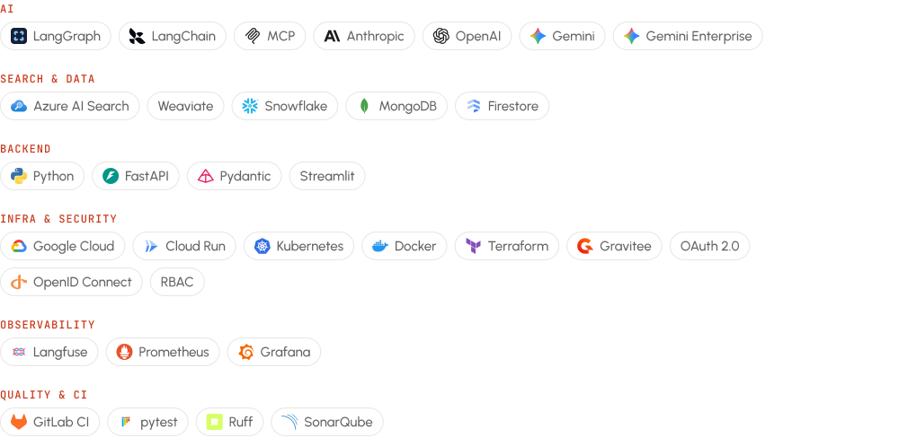

<picture>
  <source media="(prefers-color-scheme: dark)" srcset="assets/statement-dark.svg">
  
</picture>

[Experience](https://www.rafikmammeri.com/experience/) · [LinkedIn](https://www.linkedin.com/in/rafikmammeri) · [Source of the site](https://github.com/rafik-mammeri/rafikmammeri.com)

### Currently building

- **Customer relations voicebot.** Answers customer calls end to end, around 20k calls a day.
- **Conversational AI chatbot.** Customer-facing chat, around 12k conversations a day.
- **Agentic analytics on a semantic layer.** Connecting Gemini Enterprise to Snowflake through a custom MCP server, enriched with semantic views, Cortex Analyst and Cortex Search.
- **Internal agents in Gemini Enterprise.** HR and FAQ agents in production, grounded in Vertex AI Data Stores.

### Stack

<picture>
  <source media="(prefers-color-scheme: dark)" srcset="assets/tech-dark.svg">
  
</picture>
